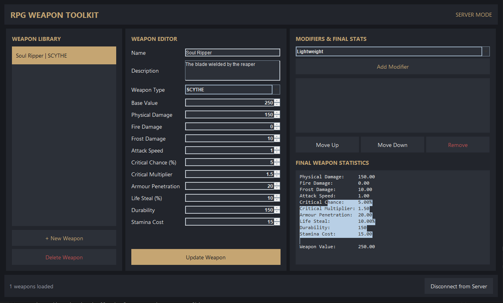
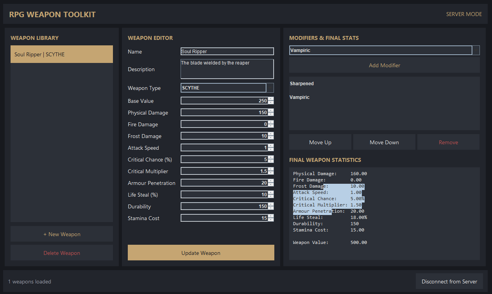
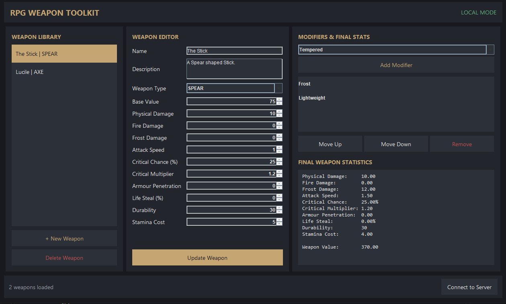
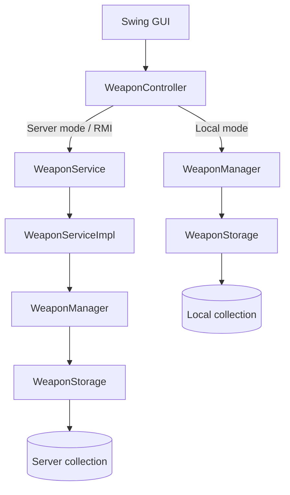

# RPG Weapon Toolkit

A desktop utility for creating, modifying and balancing weapons for RPG games. Built in Java using the Decorator design pattern, Swing, object serialization and Java RMI.

The project was developed as part of my Software Development 3 module, with the aim of applying software design patterns to a practical game development tool.

## Application Preview

## Creating Scythe Weapon on Server


## Modifying Scythe on Server


## Local Save


## Features

- Create, edit, browse and delete weapons through a desktop interface.
- Configure weapon types, descriptions, values and ten base statistics.
- Stack, remove and reorder weapon modifiers at runtime.
- Preview calculated weapon statistics without modifying the original base stats.
- Preserve weapon identity using UUIDs when editing or decorating weapons.
- Save and load weapon collections using Java object serialization.
- Work offline or connect to an optional RMI server with a separate weapon collection.
- Use a dark-themed Swing interface without external dependencies.

## Weapon Modifiers

| Modifier | Effect | Added value |
| --- | --- | ---: |
| Sharpened | +10 physical damage | 50 |
| Tempered | +25% physical damage, +20 durability | 100 |
| Flame | +15 fire damage | 150 |
| Frost | +12 frost damage | 120 |
| Vampiric | +8 percentage points of life steal | 200 |
| Berserker | +50% physical damage, -25% durability (rounded) | 175 |
| Lightweight | +50% attack speed, -20% stamina cost | 175 |

### Decorator Design Pattern

Weapons implement a common `Weapon` interface. Each decorator wraps another weapon and modifies its calculated properties while preserving its identity and underlying base statistics.

```java
Weapon upgraded = new SharpenedDecorator(sword);
upgraded = new TemperedDecorator(upgraded);
upgraded = new FlameDecorator(upgraded);
```

Modifiers can be combined without creating a separate subclass for every possible weapon configuration. Their application order matters: a weapon with 30 base damage reaches 50 damage when Sharpened is applied before Tempered, but 47.5 when the order is reversed.

## Architecture



| Package | Responsibility |
| --- | --- |
| `model` | Weapon interface, base weapon, statistics and weapon types |
| `decorators` | Abstract decorator and seven concrete modifiers |
| `management` | CRUD operations and persistent storage |
| `network` | RMI interface, service implementation and server entry point |
| `controller` | Routing between local and remote operations |
| `gui` | Swing interface, weapon editor, modifier controls and shared styling |

## Getting Started

### Requirements

- Java Development Kit (JDK 25 recommended, matching the development environment)
- No external libraries or build tools required

### Compile and run

From the project root, using PowerShell:

```powershell
javac -d bin src/Main.java src/model/*.java src/decorators/*.java src/management/*.java src/network/*.java src/controller/*.java src/gui/*.java
java -cp bin Main
```

Alternatively, open the project in a Java-compatible IDE and run `src/Main.java`.

### Optional server mode

Start the server in a separate terminal after compiling:

```powershell
java -cp bin network.Server
```

Launch the desktop application, select **Connect to Server**, and enter `localhost` when running both processes on the same machine. The RMI registry uses port `1099`.

The application starts in local mode by default and does not require a running server. Local and server collections are independent and are not automatically synchronized.

## Persistence

Weapon collections are serialized to files generated at runtime:

```text
data/
├── weapons-local.ser
└── weapons-server.ser
```

The complete decorated weapon chain is preserved when saving and loading, including the original weapon and its UUID.

## Testing

Console testing verified base weapon creation, all seven stacked modifiers, repeated stat calculations, UUID preservation, CRUD operations, serialization and deserialization. Separate client and server processes were used to verify remote CRUD operations and local operation with the server unavailable.

## Current Limitations

- Network operations are synchronous and may temporarily block the interface.
- The RMI service is intended for trusted development environments and does not implement authentication.
- Local and remote weapon collections are stored separately.
- Unsaved changes are not automatically preserved when switching weapons or collections.

## Potential Improvements

- Live stat previews when editing base statistics.
- Damage-per-second and weapon efficiency calculations.
- Side-by-side weapon comparisons and balancing charts.
- JSON import and export for integration with game engines.
- Background network operations and improved connection handling.

## Technologies

Java · Swing · Java RMI · Object Serialization · Object-Oriented Programming · Decorator Design Pattern
